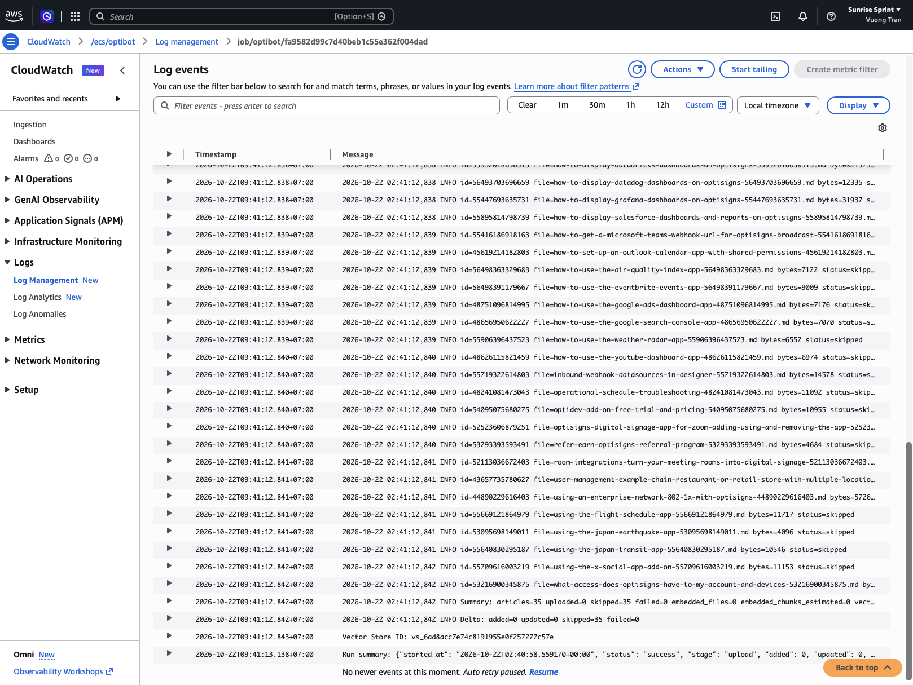
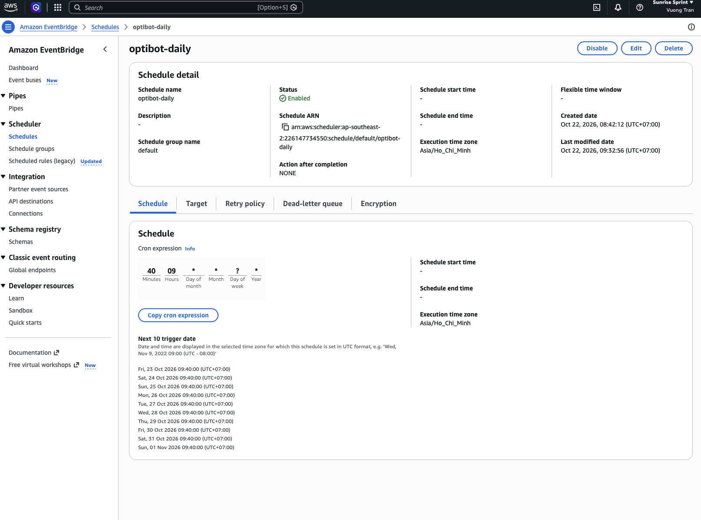

# Darkharvest

Export OptiSigns support articles to clean Markdown and sync them to an OpenAI vector store for a support assistant.

**Setup** — Python 3.11+ on macOS/Linux. Run from the repository root:

```sh
python3.11 -m venv .venv
source .venv/bin/activate
pip install -r requirements.txt
cp -n .env.example .env
```

Set `OPENAI_API_KEY` in `.env` (the API key variable used by this project).
Set `ARTICLES_DIR=articles` and leave `LIMIT=` blank to export all articles.
Optionally set `OPENAI_VECTOR_STORE_ID`; if blank, the job creates a store and
prints its ID. Save that ID in `.env` to reuse it on subsequent runs.

**Run locally** — Export articles, then upload:

```sh
python main.py                 # All articles when LIMIT is blank.
python main.py --limit 30      # Limit the fetched API records to 30.
python -m unittest discover -s tests -v
```

Relative output paths resolve against the current working directory; gitignore
custom export directories. Uploads include every Markdown file in `ARTICLES_DIR`.

**Docker** — Build and run the job once:

```sh
docker build -t optisigns-job .
docker run --rm -e OPENAI_API_KEY=... optisigns-job python main.py
```

The job exits with code `0` on success and a nonzero code on failure. To reuse a
store, also pass `-e OPENAI_VECTOR_STORE_ID=vs_...`. Exports inside the container
are removed when it exits.

**Daily job logs** — CloudWatch logs are private and require authorized AWS
access. Review the supplied [CloudWatch run screenshot](images/couldwatch_log_auto.png)
and [EventBridge schedule screenshot](images/schedule.png) as evidence.
The schedule shows a daily run at **09:40 Asia/Ho_Chi_Minh**; the captured run
reports **35 articles, 35 skipped, 0 failed**, with status `success`.

<a href="images/couldwatch_log_auto.png"></a>
<a href="images/schedule.png"></a>

**Design and limitations** — Zendesk's article API excludes page navigation;
conversion preserves headings, fenced code, and relative links. SHA-256 comparison
against vector-store attributes skips unchanged articles. Skipped/failed API
records can reduce the export count below `--limit`; images remain remote links.

**Sample assistant answer** — “How do I add a YouTube video?” The screenshot
shows instructions and a linked source guide. Click to view at full resolution.

<a href="images/assistant_answer.png"></a>
