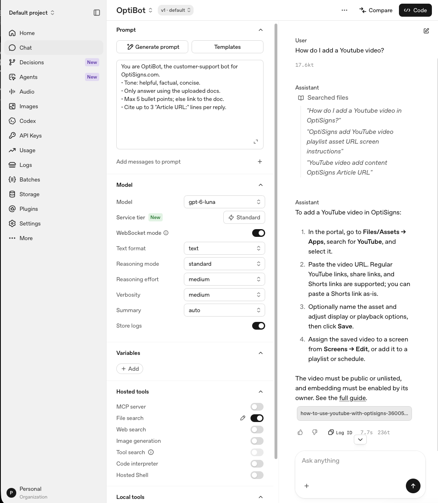

# Darkharvest

Export OptiSigns support articles as clean Markdown and synchronize them with an
existing OpenAI vector store for a support assistant.

**Setup** — Python 3.11+ on macOS or Linux. From the repository root:

```sh
python3.11 -m venv .venv
source .venv/bin/activate
python -m pip install -r requirements.txt
cp .env.example .env  # Only if you do not already have a .env file.
```

For uploads, set `OPENAI_API_KEY` and `OPENAI_VECTOR_STORE_ID` in `.env`.
Set `ARTICLES_DIR` in `.env` to the directory used for exports and uploads
(default: `articles`):

```dotenv
ARTICLES_DIR="articles"
LIMIT=
```

Leave `LIMIT` blank to process all articles. Run commands from the repository
root; relative paths resolve against the current working directory. Add any
custom generated directory inside the repository to `.gitignore`.

**Run locally**

```sh
LIMIT= python main.py                       # Export all articles, then upload.
python -m unittest discover -s tests -v     # Run tests.
```

`--limit` counts API records, so skipped or failed records can reduce the output
count. Uploads process all Markdown files in `ARTICLES_DIR`.

**Daily job logs** — TODO: add the deployed CloudWatch log-group URL here.
Local runs write `logs/scraper.log`, `logs/ingestion.log`, and `logs/last-run.json`;
the pipeline also prints its run summary to stdout for CloudWatch collection.

**Design and limitations** — Uses the public Zendesk API, preserves headings,
fenced code and relative links, and removes page clutter. Hashes detect unchanged
content. Images are not downloaded, and removed source articles are not pruned.

**Sample assistant answer** — “How do I add a YouTube video?”

<a href="images/assistant_answer.png"></a>
